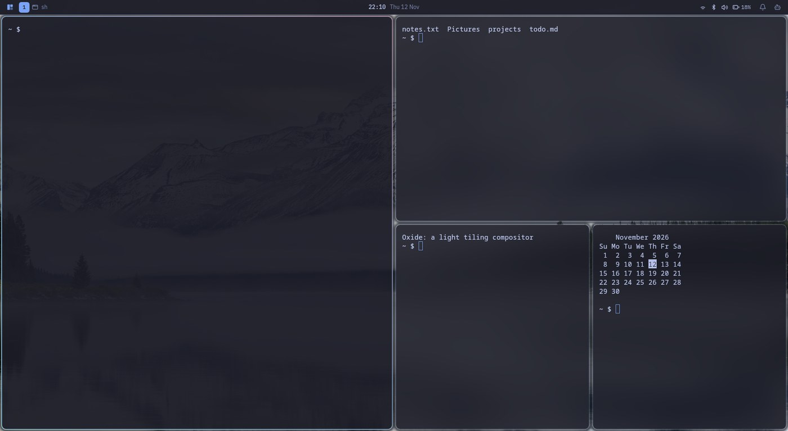
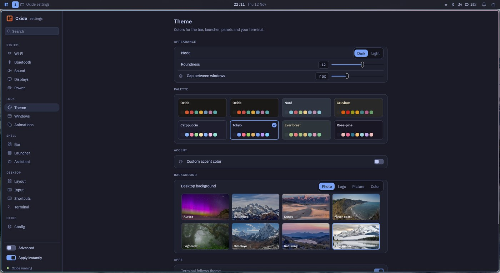

# Oxide

**A light, animated tiling Wayland compositor with a settings app that feels like a real desktop.**
Hyprland-class tiling and polish, with a graphical settings app, a themeable shell, per-window options and a
whole session that stays far below 1 GB of RAM (about 300 MB with the shell running).



## Why Oxide

| | |
|---|---|
| **Small** | One compositor binary (`oxide`, ~9 MB), a single-threaded event loop that renders only when something changed, 0 % CPU when idle. The whole session (compositor + shell + helpers) uses roughly 300 MB, and the shell is restarted automatically if it ever grows past 600 MB. |
| **Smooth** | Spring and bezier animations for opening, closing, moving, fullscreen, workspaces, borders, popups and the wallpaper. Every animation is interruptible and frame-paced to your screen. Four presets (Springy, Smooth, Snappy, Bouncy) and full per-animation control in Advanced mode. |
| **Settings that look like an app** | `oxide-settings` covers Wi-Fi, Bluetooth, sound, displays, power, theme, windows, animations, bar, launcher, layout, input, shortcuts, terminal and more. Simple by default, a lot more behind the **Advanced** switch. |
| **Per-window options** | Press `Super+O` on any window: float it, fullscreen it, send it to a workspace, or tell Oxide that **every window of this app** should always open floating, on a workspace, see-through or blurred. Undo and forget included. |
| **Overview and scratchpads** | `Super+Tab` zooms out to a live map of all workspaces where you drag windows around. Scratchpads summon a whole group of apps (music player + system monitor, say) with one key. |
| **Zero-bar mode** | Hide the bar and hold `Super` for a HUD with time, workspaces, battery and shortcuts. |
| **Tiling that pays attention** | A window with a compiler error or a video call grows on its own; borders pulse while something builds and turn red after an error. |
| **Your phone as a remote** | The Android app (in Rust) shows the screen live, PC stats, a touchpad, keyboard and media keys, and wakes PCs with Wake-on-LAN. Pair as many PCs as you like. |
| **A theme that follows you** | Eight palettes, dark and light, or **From wallpaper**: Oxide reads the colors of your wallpaper (a photo, or whatever your own shell draws) and re-colors the shell, the terminal and GTK apps. |
| **Your shell or ours** | A polished default shell (bar, launcher, quick settings, notifications, clipboard history, lock screen, AI assistant) built on [Quickshell](https://quickshell.org). Or switch to any Quickshell config of your own; the compositor, settings and theme keep working. |
| **Standard setup or your own files** | Out of the box Oxide generates a good kitty, fish and GTK setup from your theme. In Advanced mode you can switch each part to your own files and edit them in the built-in editor. |
| **Works anywhere** | Native DRM/KMS session or nested in another desktop. `oxide-ctl doctor` tells you what your distro is missing and how to install it. |

## Install in one minute

```sh
git clone https://github.com/OWNER/oxide && cd oxide
sudo apt install ... # or dnf / pacman: see docs/INSTALL.md for the exact lines
make && sudo make install          # system wide, or: contrib/install.sh for your user only
oxide-ctl doctor                   # checks the rest
```

Pick **Oxide** in your login manager, or run `oxide-session` from a TTY. Full instructions:
[docs/INSTALL.md](docs/INSTALL.md).

## First steps

* `Super+Q` terminal · `Super+R` launcher · `Super+O` options for this window · `Super+Z` quick settings ·
  `Super+,` settings · `Super+A` assistant · `Super+1…9` workspaces. The full list is in
  [docs/SHORTCUTS.md](docs/SHORTCUTS.md).
* Open **Settings** (`Super+,`). Everything you change applies instantly and is saved to
  `~/.config/oxide/oxide.toml`.



## Documentation

| | |
|---|---|
| [Getting started](docs/GETTING-STARTED.md) | A tour of the desktop in five minutes |
| [Install](docs/INSTALL.md) | Dependencies for Debian/Ubuntu, Fedora, Arch, openSUSE, NixOS; build; login manager |
| [Shortcuts](docs/SHORTCUTS.md) | Every default key and mouse binding |
| [Settings](docs/SETTINGS.md) | What each settings page does |
| [Window options & rules](docs/WINDOW-OPTIONS.md) | `Super+O` and the window rules behind it |
| [Overview, scratchpads, HUD](docs/WORKFLOW.md) | `Super+Tab`, groups of apps, zero-bar mode, smart tiling, telemetry borders, config errors |
| [Phone app](docs/PHONE.md) | Pair your phone, see and control the PC, Wake-on-LAN |
| [Theming](docs/THEMING.md) | Palettes, light/dark, wallpapers, the theme that follows your wallpaper |
| [Configuration reference](docs/CONFIG.md) | Every key of `oxide.toml` |
| [Own shells](docs/SHELLS.md) | Use your own Quickshell config, theme tokens, integration points |
| [Animations](docs/ANIMATIONS.md) | Curves, springs, styles and presets |
| [Assistant](docs/ASSISTANT.md) | The AI assistant and what it may do |
| [IPC & scripting](docs/IPC.md) | Talk to the compositor from scripts, `oxide-ctl` reference |
| [Architecture](docs/ARCHITECTURE.md) | How it is built, the memory budget, design decisions |
| [Troubleshooting](docs/TROUBLESHOOTING.md) | When something does not work |
| [Contributing](docs/CONTRIBUTING.md) | Build, test (including the nested test harness), code style |

## Status

Oxide is used daily on real hardware (DRM backend, libinput, XWayland). It is young software: expect rough
edges on unusual hardware (multi-GPU laptops, exotic input devices) and please report them with the output of
`oxide-ctl doctor` and `~/.cache/oxide/oxide.log`.

## Credits and licenses

Oxide is GPL-3.0-or-later (see [LICENSE](LICENSE)). It builds on [smithay](https://github.com/Smithay/smithay)
(MIT; a patched copy lives in `vendor/smithay`), Quickshell, egui, IBM Plex (OFL) and
[Lucide](https://lucide.dev) icons (ISC). The bundled wallpapers are real photographs from Wikimedia Commons
under their own licenses: see [contrib/wallpapers/CREDITS.md](contrib/wallpapers/CREDITS.md).
