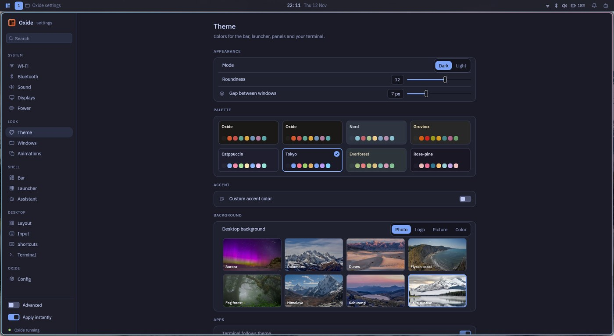

# Theming

One palette colors everything: the shell, the settings app, the terminal, GTK/Qt apps and the window borders.
Change it in *Settings → Theme*. It is saved as `[theme]` in `oxide.toml` and written out for other programs.



## Palettes

Oxide, Nord, Gruvbox, Catppuccin, Tokyo, Everforest, Rosé Pine: each in a dark and a light variant (the
**Mode** switch). **Custom accent color** replaces the accent of any palette. **Roundness** (0–20) sets the corner
radius of the bar, panels, windows and the settings app together.

## From wallpaper

The first palette card, *From wallpaper*, builds a palette from the colors of your wallpaper:
backgrounds and text take the picture's main hue, the accent comes from its most vivid color, borders get a
second color from the picture. Semantic colors (green/yellow/red) and the terminal's ANSI colors stay
readable. It works in dark and light mode and updates by itself when the wallpaper changes.

How the wallpaper is found:

* **Default shell**: from the picture you chose in *Theme → Background* (or the color; with *Logo* the standard
  palette colors are used).
* **Your own shell** (or a wallpaper tool such as swww, hyprpaper): Oxide looks at what the background layer is
  showing, a moment after it stops changing, so any wallpaper setup works. Switching to an own shell in
  *Settings → Shells* selects this palette for you.

The result is stored in `~/.config/oxide/auto-theme.json` (hue, tint, accent, second color).

## Wallpapers

*Theme → Background* (default shell):

* **Photo**: eight real photographs are included (credits in `contrib/wallpapers/CREDITS.md`). Drop your own
  `jpg`/`png` files into `~/.local/share/oxide/wallpapers/` and they appear in the grid.
* **Logo**: a quiet background in your palette with the Oxide tiles.
* **Picture**: any image file, with *Fill*, *Fit* or *Center*.
* **Color**: a flat color.

Changing the wallpaper cross-fades. The choice lives in `~/.config/oxide/wallpaper.json`:

```json
{ "mode": "photo", "photo": "dolomites" }
{ "mode": "image", "path": "/home/me/Pictures/wall.jpg", "fit": "fill" }
{ "mode": "color", "color": "#1b1917" }
{ "mode": "theme" }
```

## What gets themed

| Target | How |
|---|---|
| The shell | reads `~/.config/oxide/theme.json` live (colors fade) |
| The settings app | follows the palette, with a fade when it changes |
| kitty | `~/.config/oxide/kitty-theme.conf`, included from your kitty.conf; open kitties reload |
| fish | the standard fish configuration uses the palette (or leave yours alone in *Own configs*) |
| GTK 3/4 and Qt | color scheme, accent and window colors (switch to your own GTK files in *Advanced → Own configs*) |
| Window borders | *Theme → Apps → Window borders → Match theme* copies the palette's border colors |

`theme.json` has these keys (all `#rrggbb`): `bg surface raised line text muted accent accent_soft ink good warn bad
blue`, plus `ansi` (16 terminal colors), `border` (gradient list), `border_inactive`, `light` (bool), `radius`.
Own shells read the same file: see [SHELLS.md](SHELLS.md).
