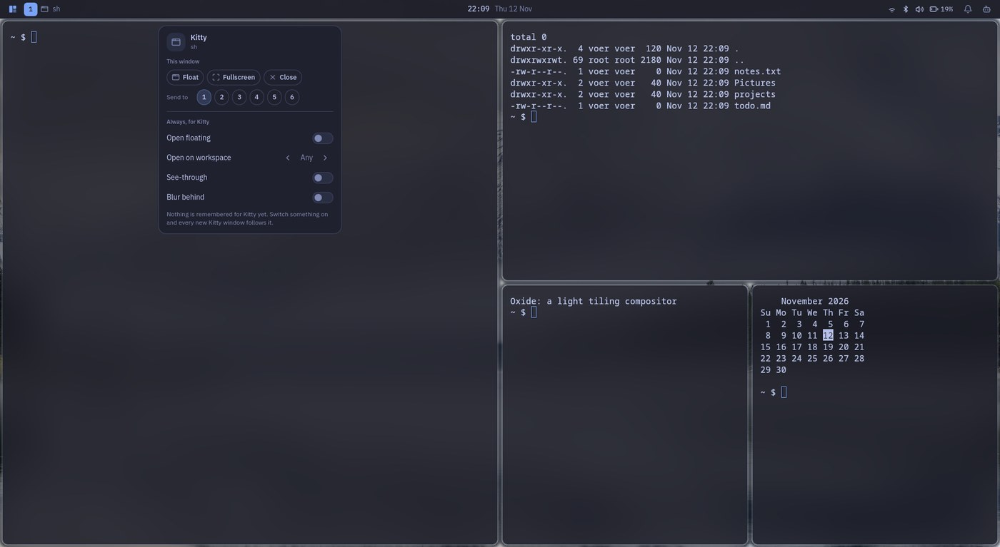

# Window options and rules

`Super+O` (or a click on the window title in the bar) opens a panel under the focused window.



## This window

Acts immediately and is not remembered.

* **Float** toggles between tiled and floating (a floating window keeps its size when you move it).
* **Fullscreen** (the panel closes, the window grows to cover the screen; the bar steps aside).
* **Close** asks the application to close.
* **Send to** moves the window to workspace 1–6 (use `Super+Shift+N` for any workspace).

## Always, for this app

Remembered for every window of the same application (matched by its app id, e.g. `kitty`, `org.kde.dolphin`).
Each setting you switch on becomes a **window rule** in `oxide.toml`; they apply to the open windows right away
(see-through, blur) or to the next window of that app (floating, workspace).

| Setting | Meaning |
|---|---|
| **Open floating** | New windows of this app start floating |
| **Open on workspace** | New windows go to this workspace (`Any` = where you are) |
| **See-through** | The app is drawn with reduced opacity (0.40–1.00; the slider appears when it is on) |
| **Blur behind** | The wallpaper behind it is blurred (needs *Blur* on in *Settings → Windows*) |

**Undo** (also `Z` while the panel is open) restores what the rule was before your last change. **Forget these
settings** removes the rule. `F` toggles floating from the keyboard; `Esc` closes the panel.

## Rules in the config

The panel edits `[[rule]]` entries, which you can also write by hand or edit in *Settings → Apps → Window rules*
(Advanced mode):

```toml
[[rule]]
app_id = "pavucontrol"      # matched without regard to case
floating = true

[[rule]]
app_id = "firefox"
title = "Picture-in-Picture" # optional: the title contains this text
floating = true
workspace = 3
opacity = 0.92
blur = true
```

All fields except the match (`app_id` and/or `title`) are optional. Rules are applied in file order; a later rule
overrides an earlier one. Dialogs and other transient windows float by default.

## From a script

```sh
oxide-ctl rule kitty floating=true workspace=2 opacity=0.9 blur=true
oxide-ctl rule kitty floating=-          # "-" removes one setting
```

This writes the config file and applies the change live. It is what the panel runs.
